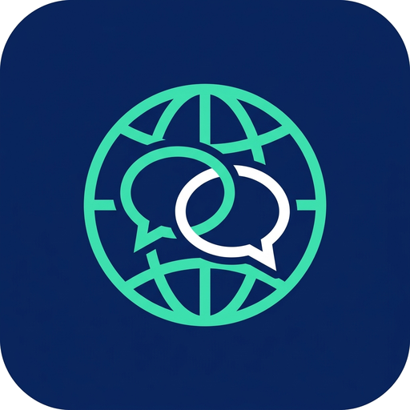

<div align="center">



# Parlex

**Next-Generation On-Device Neural Translation & AI Intelligence for Android**

*100% On-Device Neural Translation • No Telemetry • No User-Text Uploads • Optional Model/Rate Downloads*

[](https://github.com/RandoTeam/Parlex/actions/workflows/android-check.yml)
[](https://github.com/RandoTeam/Parlex/releases/tag/v1.5.1-beta.10)
[-34A853?logo=android&logoColor=white&style=flat-square)](https://developer.android.com)
[](https://developer.android.com/ndk/guides/abis)
[](LICENSE)
[](https://github.com/RandoTeam/Parlex)
[](https://kotlinlang.org)
[](https://isocpp.org)
[](https://github.com/ggml-org/llama.cpp)
[](https://ai.google.dev/edge/litert)

[Overview](#overview--philosophy) • [Feature Status Matrix](#feature-status-matrix) • [Translation Engines & Models](#translation-engines--model-catalog) • [Snapdragon NPU Roadmap](#hardware-acceleration--snapdragon-npu-roadmap) • [Languages](#supported-languages--lexicon) • [Build & Verification](#build-requirements--verification) • [Documentation](docs/INDEX.md) • [Roadmap](ROADMAP.md) • [Privacy](PRIVACY.md) • [Security](SECURITY.md) • [Legal](docs/LEGAL.md) • [Support the Author](#support-the-solo-developer)

</div>

---

> [!NOTE]
> **Built by a Solo Developer with Dedication & Precision**  
> Parlex is engineered completely independently without corporate backing, data collection, or subscription paywalls. It brings high-performance, private, zero-latency on-device AI translation directly to Android hardware. If you find this project valuable, please consider [supporting independent development](#support-the-solo-developer).

---

## Overview & Philosophy

**Parlex** is an autonomous offline AI translation ecosystem designed for privacy-first, on-device intelligence. Unlike traditional cloud translators that upload personal communications, screen contents, or audio recordings to remote servers, Parlex executes all neural translation, optical character recognition (OCR), and speech recognition (STT) directly on the device's silicon.

```text
┌──────────────────────────────────────────────────────────────────────────────────┐
│                             Android Compose 1.7 UI                               │
│  [Text Translation]   [Voice Dialogue]   [AR Screen Overlay]   [Camera Travel]   │
└────────────────────────────────────────┬─────────────────────────────────────────┘
                                         │
┌────────────────────────────────────────▼─────────────────────────────────────────┐
│                    Hybrid Dual-Tier Translation Controller                       │
├────────────────────────────────────────┬─────────────────────────────────────────┤
│    Tier 1: Fast NMT (On-Device)        │     Tier 2: Primary Neural LLM (JNI)     │
│    • Google ML Kit NMT Engine          │     • llama.cpp C++17 Runtime           │
│    • 59 Languages • ~30ms Latency      │     • Tencent Hy-MT 1.5 & Hy-MT2 (1.8B) │
│    • 0 MB LLM RAM Consumption          │     • Google TranslateGemma 4B          │
│    • .parlex-fast Offline Sync         │     • Qualcomm Adreno OpenCL Offload    │
└────────────────────────────────────────┴─────────────────────────────────────────┘
                                         │
┌────────────────────────────────────────▼─────────────────────────────────────────┐
│                           Perception & Utility Engines                           │
│  • Sherpa-ONNX (Whisper Tiny + Silero VAD)     • PP-OCRv6 Tiny (optional MNN)  │
│  • ICU 74 Transliteration Engine              • SQLite Room DB v5 Lexicon        │
└──────────────────────────────────────────────────────────────────────────────────┘
```

### Core Tenets
1. **100% Offline & Sovereign**: Operates seamlessly in airplane mode, remote regions, or high-security facilities. Zero network requests during translation.
2. **Zero Telemetry**: No trackers, no user analytics, no logging of translated phrases or audio.
3. **Instant Latency & Scalability**: Microsecond Fast NMT for daily instant interactions combined with full-parameter 1.8B/7B LLMs for complex, context-aware translation.
4. **Complete Technical Transparency**: Honest, non-inflated feature status reporting across all modules.

---

## Feature Status Matrix

To avoid false expectations, Parlex maintains an honest, transparent breakdown of what is fully reliable versus what is experimental or undergoing active refactoring. **Recovery work (2026-10-21)** is tracked in `docs/AUDIT_AND_RECOVERY_PLAN_2026-10-21.md`; rows below are updated after the first stabilization pass.

| Feature Domain | Module / Implementation | Status | Realistic Current State |
| :--- | :--- | :---: | :--- |
| **Text Translation** | `TranslationScreen.kt` | 🟢 **Stable** | **Production-ready.** Automatic source language detection, persistent bidirectional language selection, one-tap clipboard copy, TTS voice playback, and SQLite Room DB v5 history with favorites. |
| **Model Management** | `ModelManagerScreen.kt` | 🟢 **Stable** | **Production-ready.** 5-step numbered offline downloads hierarchy, EMA-smoothed download metrics (speed, ETA, bytes), and `.parlex-fast` single-file catalog import/export. |
| **Transliteration** | `TransliterationEngine.kt` | 🟢 **Stable** | **Production-ready on Android 10+.** Fully offline romanization/transliteration for Cyrillic, CJK (Pinyin/Romaji), Arabic, Devanagari, Thai, and Hangul via ICU4J. |
| **Offline Lexicon** | `TransLiveDatabase.kt` | 🟢 **Stable** | **Production-ready.** Fast grammatical dictionary lookups and offline TSV lexicon import. |
| **Currency Converter** | `ExchangeRateRepository.kt` | 🟢 **Stable** | **Production-ready.** Real-time on-screen currency regex detection (`$`, `€`, `₫`, `₽`) with baseline offline conversion. |
| **Voice Dialogue** | `DialogueScreen.kt` | 🟡 **Beta** | **Recovery pass applied.** TTS has a hard timeout and per-utterance callbacks; ASR decoding is decoupled from the microphone read loop; AEC/NS and audio focus are enabled when available; turn audio timing is measured instead of hardcoded. Still needs on-device acoustic tuning and streaming partials. |
| **Floating HUD** | `MiniOverlayHudView.kt` | 🟡 **Beta** | **Functional.** Docked edge controls with Fast NMT vs Smart LLM toggle, quick language carousel, and one-tap screenshot export to `Pictures/Parlex/`. |
| **Camera & Photo Translation** | `CameraScreen.kt` | 🟠 **Alpha (Partial)** | **Recovery + redesign.** Live translation overlay restored; gallery imports auto-detect source; rapid picks are generation-guarded; zero-copy crop path; 0.6/1/3x zoom, orange shutter and compact glass controls. Device acceptance is still pending. |
| **Screen Translation** | `ScreenTranslateOverlayService.kt` | 🟠 **Beta (Recovery)** | **Major layout/session fixes.** Translations fit inside source blocks; erase masks stay anchored; mixed-language pairs; repeated shortcut/bubble lifecycle, rotation/window dismissal and rendered-overlay save. Hardware back/TalkBack/device UX remain to verify. |
| **LiteRT-LM Engine** | `LiteRtTranslationEngine.kt` | 🔴 **Experimental** | Google LiteRT-LM GPU runtime for Gemma 4 models (E2B / E4B). |
| **Multimodal Vision LLMs** | `VisionLlmComponents.kt` | 🔵 **Planned** | Catalog only; not wired into the app. Do not treat as a shipped feature until a phase in the recovery plan is complete. |
| **AngelSlim Dequant** | R&D (planned kernels) | 🔴 **Experimental** | Custom ARM NEON kernels for Tencent AngelSlim 1.25-bit/2-bit weights; not shipped in beta.8. |
| **Snapdragon NPU Offload**| Qualcomm QNN / LiteRT NPU | 🔵 **Roadmap** | Direct neural offload to Qualcomm Hexagon Tensor Accelerator (LiteRT backend exists; device verification still pending). |

---

## Translation Engines & Model Catalog

Parlex uses a multi-tier neural architecture. Models are downloaded on demand or imported manually by the user; no proprietary model weights are vendored inside this git repository.

### 1. Fast NMT Engine (Google ML Kit CDN • On-Device)
- **Profile**: ~30 ms inference latency, 0 MB LLM RAM consumption.
- **Language Support**: **59 languages** covering Europe, the Americas, Asia, and the Middle East.
- **Offline Portability**: Single-file `.parlex-fast` archive import/export allows sharing complete translation packs directly between devices without internet access (via Bluetooth or local storage).
- **License**: Apache 2.0 / Google ML Kit Terms of Service.

### 2. Primary Neural LLM Translators (llama.cpp GGUF)

#### Tencent Hy-MT Family
Tencent's translation-specialized models are trained specifically for cross-lingual accuracy, idiom preservation, and high-fidelity nuance across 33 languages.

| Model | Parameters | Recommended Quant | Download Size | Est. RAM | Official Source | License |
| :--- | :---: | :---: | :---: | :---: | :--- | :--- |
| **Hy-MT 1.5** | 1.8B | `Q4_K_M` ⭐ | 1.13 GB | ~1.8 GB | [tencent/HY-MT1.5-1.8B-GGUF](https://huggingface.co/tencent/HY-MT1.5-1.8B-GGUF) | Tencent Community (non-EU/UK/KR) |
| **Hy-MT2 Mobile** | 1.8B | `Q4_K_M` ⭐ | 1.13 GB | ~1.8 GB | [tencent/Hy-MT2-1.8B-GGUF](https://huggingface.co/tencent/Hy-MT2-1.8B-GGUF) | Apache 2.0 |
| **Hy-MT2 Quality**| 7B | `Q4_K_M` ⭐ | 4.62 GB | ~6.5 GB | [tencent/Hy-MT2-7B-GGUF](https://huggingface.co/tencent/Hy-MT2-7B-GGUF) | Apache 2.0 |

> **Quantization Guide for Mobile Devices:**
> - `Q4_K_M` **(Recommended for Daily Use)**: The proven sweet spot for mobile RAM and execution speed. Delivers >98% of FP16 translation accuracy while running comfortably on phones with 8 GB+ RAM.
> - `Q6_K` / `Q8_0` **(Flagship Precision)**: Best suited for flagship devices with 12 GB–16 GB RAM where zero quantization loss is prioritized.
> - `1.25bit` / `2bit` **(AngelSlim - Experimental R&D)**: Ultra-compact research models from Tencent. Standard GGML parsers reject these due to non-standard tensor structures; Parlex is actively researching dedicated dequantization kernels for future releases.

#### Google TranslateGemma & Gemma 4 Family
Specialized translation models derived from Google's Gemma architecture, optimized for high-fidelity translation across 55 languages with official GGUF and LiteRT-LM GPU runtimes.

| Model | Parameters | Recommended Quant / Format | Download Size | Est. RAM | Official Source | License |
| :--- | :---: | :---: | :---: | :---: | :--- | :--- |
| **TranslateGemma** | 4B | `Q4_K_M` ⭐ | 2.49 GB | ~3.2 GB | [mradermacher/translategemma-4b-it-GGUF](https://huggingface.co/mradermacher/translategemma-4b-it-GGUF) | Gemma Terms of Use |
| **Gemma 4 E2B** | 2B | `GPU LiteRT (.litertlm)` ⭐ | 2.01 GB | ~3.0 GB | [litert-community/gemma-4-E2B-it-litert-lm](https://huggingface.co/litert-community/gemma-4-E2B-it-litert-lm) | Apache 2.0 |
| **Gemma 4 E4B** | 4B | `QAT INT4/INT8 (.litertlm)` | 3.66 GB | ~4.0 GB | [litert-community/gemma-4-E4B-it-litert-lm](https://huggingface.co/litert-community/gemma-4-E4B-it-litert-lm) | Apache 2.0 |

### 3. Speech Recognition (STT) & Audio Perception

| Engine / Model | Primary Task | Language Coverage | Architecture | Download Size | Est. RAM | License |
| :--- | :--- | :---: | :--- | :---: | :---: | :--- |
| **Whisper Tiny** | Multilingual STT | 99 Languages | OpenAI Encoder-Decoder (sherpa-onnx) | ~75 MB | ~150 MB | MIT |
| **SenseVoice-Small** | High-Speed ASR | ZH, EN, JA, KO, YUE | Non-autoregressive INT8 | ~140 MB | ~200 MB | MIT |
| **Zipformer** | Streaming STT | English / Chinese | Emformer Transducer | ~50–95 MB | ~120 MB | Apache 2.0 |
| **Silero VAD** | Turn Detection | Universal Audio | Deep Neural Voice Activity Detector | ~2 MB | ~15 MB | MIT |

### 4. Vision & Optical Character Recognition (OCR)

| Engine / Model | Primary Task | Language Support | Runtime | Model Size | Est. RAM | License |
| :--- | :--- | :---: | :--- | :---: | :---: | :--- |
| **PP-OCRv6 Tiny** | On-Device Text OCR | Multilingual | Alibaba MNN Framework (optional native build) | ~12 MB | ~40 MB | Apache 2.0 |
| **Tesseract OCR** | Document OCR Fallback | 14 bundled scripts | Tesseract4Android Native | ~15–30 MB | ~50 MB | Apache 2.0 |
| **MiniCPM-V 4.6** | Multimodal Layout Analysis | Multilingual | GGUF Vision (Experimental) | ~1.3 GB | ~2.2 GB | Apache 2.0 |

### 5. 1-Click Offline Travel Packs (Step 5)
In the Model Manager, **Step 5 Travel Packs** provide unified 1-click bundles combining:
1. Fast NMT translation model
2. Bilingual offline grammar lexicon
3. Whisper / SenseVoice STT offline voice recognition
Available for high-frequency travel pairs: RU-EN, ZH-EN, VI-EN, ES-EN, JA-EN, DE-EN, and FR-EN.

---

## Hardware Acceleration & Snapdragon NPU Roadmap

```text
[Current Generation: GPU Acceleration]           [Next-Generation: NPU Offloading]
┌─────────────────────────────────────┐         ┌─────────────────────────────────────┐
│  Qualcomm Adreno GPU (OpenCL 2.0)   │         │  Qualcomm Hexagon NPU (QNN Direct)  │
│  • Adreno 630 (Snapdragon 845)      │   ───►  │  • Snapdragon 8 Gen 2 / Gen 3 / 8E  │
│  • Adreno 750 (Snapdragon 8 Gen 3)  │         │  • ~70% Lower Power (0.8W vs 5W)    │
│  • Adreno 830 (Snapdragon 8 Elite)  │         │  • Zero Thermal Throttling          │
│  • Dynamic RAM & Layer Scaling      │         │  • Dedicated INT4 / INT8 Hardware   │
└─────────────────────────────────────┘         └─────────────────────────────────────┘
```

### Current: Multi-Generation Snapdragon Adreno GPU Engine
Parlex features an adaptive hardware profiling engine (`AdrenoProfileRegistry.kt`) with dynamic GPU layer offload:
- **Snapdragon 845 (Adreno 630)**: Baseline OpenCL 2.0 offload (~6–10 layers, 128 batch size).
- **Snapdragon 8 Gen 2 / Gen 3 (Adreno 740 / 750)**: High offload (~18–26 layers, 256 batch size).
- **Snapdragon 8 Elite (Adreno 830 / OnePlus 13 Reference)**: Full offload (all 28–32 layers on GPU, 512 batch size, 40+ tokens/sec).
- **Memory Safety**: Queries `/proc/meminfo` (`MemAvailable`) dynamically prior to allocation to prevent Android Low Memory Killer (`LMK`) events.

### The Future: Qualcomm Hexagon NPU Offloading
While GPU acceleration provides high throughput, prolonged conversational translation on mobile GPUs consumes between 4W and 7W of power, causing device warming and battery drain.

**The NPU Architectural Plan:**
1. **Hexagon Tensor Accelerator (HTA) Integration**: Native integration with the **Qualcomm AI Engine Direct (QNN) SDK** to execute neural weights directly on the Hexagon NPU.
2. **Thermal & Battery Optimization**: Reduces power consumption to ~0.8W–1.5W, allowing continuous hours of hands-free conversation with virtually zero device warming.
3. **Dedicated INT4/INT8 Quantization**: Tailored integer quantization profiles mapped directly to Qualcomm Hexagon Vector eXtensions (HVX), bypassing CPU/GPU pipelines entirely.

---

## Supported Languages & Lexicon

### Fast NMT Catalog (59 Languages)
Afrikaans, Albanian, Arabic, Belarusian, Bengali, Bulgarian, Catalan, Chinese (Simplified), Chinese (Traditional), Croatian, Czech, Danish, Dutch, English, Esperanto, Estonian, Finnish, French, Galician, Georgian, German, Greek, Gujarati, Haitian Creole, Hebrew, Hindi, Hungarian, Icelandic, Indonesian, Irish, Italian, Japanese, Kannada, Korean, Latvian, Lithuanian, Macedonian, Malay, Maltese, Marathi, Norwegian, Persian, Polish, Portuguese, Romanian, Russian, Slovak, Slovenian, Spanish, Swahili, Swedish, Tagalog (Filipino), Tamil, Telugu, Thai, Turkish, Ukrainian, Urdu, Vietnamese.

### Primary LLM Language Coverage (Hy-MT 33 Languages)
Arabic, Bengali, Bulgarian, Burmese, Chinese, Croatian, Czech, Danish, Dutch, English, Finnish, French, German, Greek, Hebrew, Hindi, Hungarian, Indonesian, Italian, Japanese, Khmer, Korean, Malay, Polish, Portuguese, Russian, Spanish, Swedish, Tagalog, Thai, Turkish, Ukrainian, Vietnamese.

---

## Build Requirements & Verification

### Prerequisites
- Android Studio Ladybug / Meerkat or command-line SDK.
- Android SDK Platform 36 & Build-Tools `36.0.0`.
- Android NDK `27.3.13750724`.
- CMake `3.22.1`.
- Java Development Kit (JDK) 21 (local Gradle targets Java 17 bytecode).
- Gradle Wrapper `9.4.1`.
- Physical device or emulator with `arm64-v8a`, Android 8.0+ (`minSdk 26`).

### Clean Clone & Native Submodule Setup
```powershell
git clone https://github.com/RandoTeam/Parlex.git
cd Parlex

# Restores OpenCL headers, the link-time libOpenCL.so stub, and the exact
# llama.cpp revision recorded in app/src/main/cpp/llama.cpp.version.
# A clean clone also builds a CPU-only APK without this step.
powershell -ExecutionPolicy Bypass -File scripts/setup-native.ps1
```

### Build Commands
```powershell
# Assemble Debug APK (for local development only)
.\gradlew.bat assembleDebug --no-daemon

# Run Unit Test Suite
.\gradlew.bat :app:testDebugUnitTest

# Assemble Signed Release APK (requires keystore.properties)
.\gradlew.bat assembleRelease --no-daemon
```

### Verification & Signatures (v1.5.1-beta.10)
```powershell
# Verify APK Signature Scheme v2
& "$env:ANDROID_HOME\build-tools\36.0.0\apksigner.bat" verify --verbose --print-certs app/build/outputs/apk/release/app-release.apk

# Verify Package Metadata
& "$env:ANDROID_HOME\build-tools\36.0.0\aapt2.exe" dump badging app/build/outputs/apk/release/app-release.apk | Select-String "package:"
```

- **Package**: `com.translive.app`
- **Version**: `1.5.1-beta.10` (`versionCode: 15110`)
- **Target SDK**: `36` • **Min SDK**: `26`
- **Official APK SHA-256**: `abe26eb4907079940d6680ec7686026f26a983e87062e247fb8528a76ea6e340`

---

## Support the Solo Developer

Parlex is created, developed, and maintained by a single engineer who believes in digital sovereignty, open-source intelligence, and the right to private communication without corporate surveillance.

Every line of Kotlin, JNI C++, and shader code, as well as hardware profiling for Snapdragon devices, is researched and written with care. If Parlex saves your time, assists your travels, or inspires your projects, your sponsorship directly funds physical test devices, high-end mobile hardware for NPU research, and continuous updates.

### 💖 Donation & Sponsorship Channels

#### 💳 Direct Banking & Regional Transfers
- **T-Bank Money Collection** *(Russia & CIS / SBP & Cards)*: [www.tbank.ru/cf/9YuuZydrQlI](https://www.tbank.ru/cf/9YuuZydrQlI)  
  *Direct 1-click transfer via Fast Payments System (SBP) or Russian bank cards.*
- **Kaspi Bank** *(Kazakhstan & Central Asia)*: `+7 707 390-30-49`  
  *Direct transfer via Kaspi Gold by phone number.*

---

## Documentation

- [Documentation index](docs/INDEX.md)
- [Product vision](docs/PRODUCT_VISION.md)
- [Architecture](docs/ARCHITECTURE.md)
- [Roadmap](ROADMAP.md)
- [Development pipeline](docs/PIPELINE.md)
- [Quality gates](docs/QUALITY_GATES.md)
- [Device QA](docs/DEVICE_QA.md)
- [Releases](docs/RELEASES.md)
- [Current project snapshot](PROJECT_STAGE.md)
- [Developer handoff](HANDOFF.md)

---

## License & Attribution

- **Application Code**: Licensed under the [MIT License](LICENSE).
- **Third-Party Libraries & Models**: Each runtime and model family is governed by its respective license. Review [THIRD_PARTY_NOTICES.md](THIRD_PARTY_NOTICES.md) and [docs/LEGAL.md](docs/LEGAL.md) for complete details.
- **Privacy**: [PRIVACY.md](PRIVACY.md).
- **Security reports**: [SECURITY.md](SECURITY.md) — please use the private Security tab, not a public issue.
