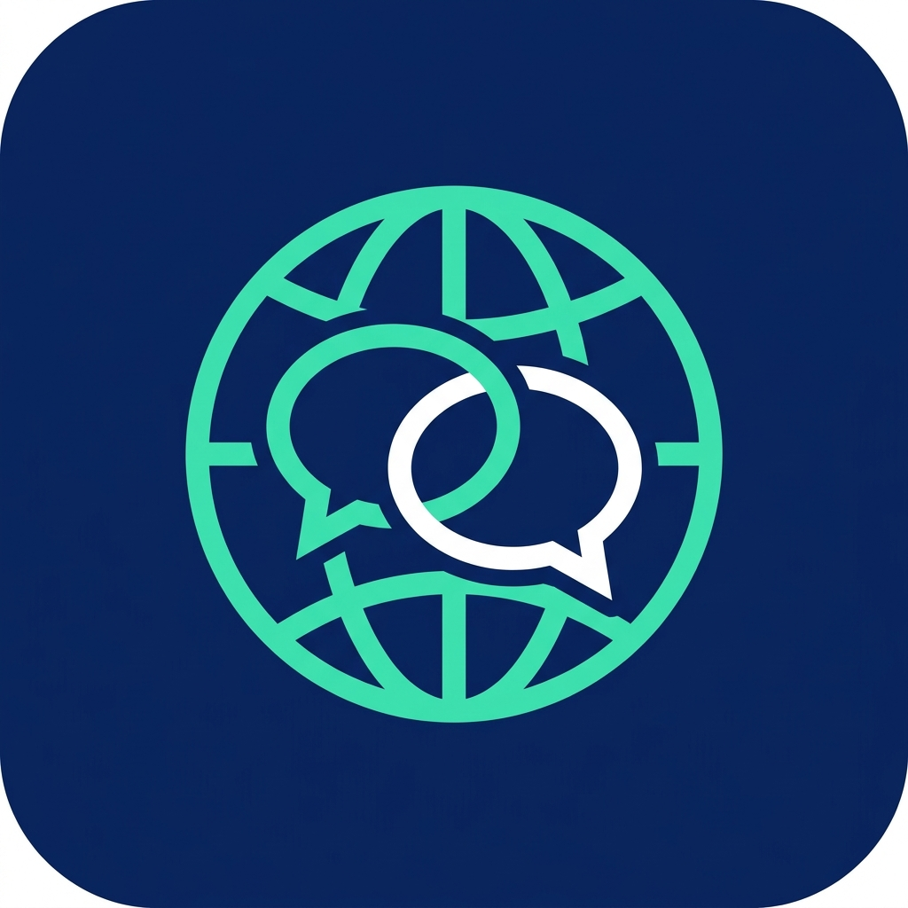

<div align="center">



# Parlex

**Next-Generation On-Device Neural Translation & AR Screen Intelligence for Android**

*100% Local Neural Inference • Zero Network Calls • Zero Telemetry • Complete Privacy*

[](https://github.com/RandoTeam/Parlex/releases/tag/v1.5.1-beta.1)
[-34A853?logo=android&logoColor=white&style=flat-square)](https://developer.android.com)
[](https://developer.android.com/ndk/guides/abis)
[](LICENSE)
[](https://github.com/RandoTeam/Parlex)
[](https://kotlinlang.org)
[](https://isocpp.org)
[](https://github.com/ggml-org/llama.cpp)
[](https://ai.google.dev/edge/litert)

[Overview](#overview--philosophy) • [Feature Status Matrix](#feature-status-matrix) • [Translation Engines & Models](#translation-engines--model-catalog) • [Snapdragon NPU Roadmap](#hardware-acceleration--snapdragon-npu-roadmap) • [Languages](#supported-languages--lexicon) • [Build & Verification](#build-requirements--verification) • [Support the Author](#support-the-solo-developer)

</div>

---

> [!NOTE]
> **Built by a Solo Developer with Dedication & Precision**  
> Parlex is engineered completely independently without corporate backing, data collection, or subscription paywalls. It brings high-performance, private, zero-latency on-device AI translation directly to Android hardware. If you find this project valuable, please consider [supporting independent development](#support-the-solo-developer).

---

## Overview & Philosophy

**Parlex** is an autonomous offline AI translation ecosystem designed for privacy-first, on-device intelligence. Unlike traditional cloud translators that upload personal communications, screen contents, or audio recordings to remote servers, Parlex executes all neural translation, optical character recognition (OCR), and speech recognition (STT) directly on the device's silicon.

```text
┌──────────────────────────────────────────────────────────────────────────────────┐
│                             Android Compose 1.7 UI                               │
│  [Text Translation]   [Voice Dialogue]   [AR Screen Overlay]   [Camera Travel]   │
└────────────────────────────────────────┬─────────────────────────────────────────┘
                                         │
┌────────────────────────────────────────▼─────────────────────────────────────────┐
│                    Hybrid Dual-Tier Translation Controller                       │
├────────────────────────────────────────┬─────────────────────────────────────────┤
│    Tier 1: Fast NMT (On-Device)        │     Tier 2: Primary Neural LLM (JNI)     │
│    • Google ML Kit NMT Engine          │     • llama.cpp C++17 Runtime           │
│    • 59 Languages • ~30ms Latency      │     • Tencent Hy-MT 1.5 & Hy-MT2 (1.8B) │
│    • 0 MB LLM RAM Consumption          │     • Google TranslateGemma 4B          │
│    • .parlex-fast Offline Sync         │     • Qualcomm Adreno OpenCL Offload    │
└────────────────────────────────────────┴─────────────────────────────────────────┘
                                         │
┌────────────────────────────────────────▼─────────────────────────────────────────┐
│                           Perception & Utility Engines                           │
│  • Sherpa-ONNX (Whisper Tiny + Silero VAD)     • PP-OCRv6 Tiny (Alibaba MNN)     │
│  • ICU 74 Transliteration Engine              • SQLite Room DB v5 Lexicon        │
└──────────────────────────────────────────────────────────────────────────────────┘
```

### Core Tenets
1. **100% Offline & Sovereign**: Operates seamlessly in airplane mode, remote regions, or high-security facilities. Zero network requests during translation.
2. **Zero Telemetry**: No trackers, no user analytics, no logging of translated phrases or audio.
3. **Instant Latency & Scalability**: Microsecond Fast NMT for daily instant interactions combined with full-parameter 1.8B/7B LLMs for complex, context-aware translation.
4. **Transparent Asset Management**: Complete transparency regarding model origin, open-source licensing, memory bounds, and download integrity.

---

## Feature Status Matrix

| Feature Domain | Module / Implementation | Status | Description |
| :--- | :--- | :---: | :--- |
| **Text Translation** | `TranslationScreen.kt` | 🟢 **Stable** | Source auto-detection, bidirectional persistence, one-tap clipboard copy, TTS voice output, Room DB v5 history with favorites. |
| **Voice Dialogue** | `DialogueScreen.kt` | 🟢 **Stable** | Hands-free continuous loop, synchronized dual-speaker waveform visualizer, AAC 48 kbps / 16-bit PCM WAV background recording, scrub/seek timeline (1.0x–2.0x), CJK & bilingual analytics card. |
| **Model Management** | `ModelManagerScreen.kt` | 🟢 **Stable** | 5-step numbered offline downloads hierarchy, EMA-smoothed download metrics (speed, ETA, bytes), and `.parlex-fast` single-file catalog import/export. |
| **Transliteration** | `IcuTransliterator.kt` | 🟢 **Stable** | Fully offline romanization for Cyrillic, CJK (Pinyin/Romaji), Arabic, Devanagari, Thai, and Hangul. |
| **Offline Lexicon** | `TransLiveDatabase.kt` | 🟢 **Stable** | Fast grammatical dictionary lookups and offline TSV lexicon import. |
| **Currency Converter** | `ExchangeRateRepository.kt` | 🟢 **Stable** | Real-time on-screen currency detection (`$`, `€`, `₫`, `₽`) with baseline offline conversion. |
| **Screen Translation** | `ScreenTranslateOverlayService.kt` | 🟡 **Beta** | Zero-latency direct `AccessibilityNodeInfo` BFS extraction (0ms on native apps, bypassing MediaProjection dialogue), 1-pass delimited batch translation (`FastBatchTranslator`), and in-place AR text replacement (`ArBoundingBoxClusterer`). |
| **Hardware Key Trigger** | `ScreenAccessibilityService.kt` | 🟡 **Beta** | Decoupled volume key / shortcut triggers (`SINGLE_SHOT_NO_BUBBLE` for instant AR overlay without persistent bubble vs `TOGGLE_FLOATING_BUBBLE`). |
| **Camera Travel Mode** | `CameraScreen.kt` | 🟡 **Beta** | Live CameraX capture, 2-stage OCR box clustering, luminance-aware gradient inpainting, interactive inspection sheet, and dietary allergen classification across 33 languages. |
| **Floating HUD** | `MiniOverlayHudView.kt` | 🟡 **Beta** | Expandable docked HUD with Fast NMT vs Smart LLM toggle, quick language carousel, and one-tap screenshot export to `Pictures/Parlex/`. |
| **LiteRT-LM Engine** | `LiteRtTranslationEngine.kt` | 🟠 **Experimental** | Google LiteRT-LM GPU runtime for Gemma 4 models (E2B / E4B). |
| **Multimodal Vision LLM** | `VisionLlmComponents.kt` | 🟠 **Experimental** | On-device visual understanding via MiniCPM-V 4.6 (1.3B INT4), SmolVLM-2 (500M INT4), and Gemma 4 Edge E2B (2.0B INT4) for layout analysis. |
| **AngelSlim Dequant** | `ggml-angelslim.c` (R&D) | 🟠 **Experimental** | Custom ARM NEON kernels for Tencent AngelSlim proprietary 1.25-bit (~440 MB) and 2-bit (~573 MB) weights. |
| **Snapdragon NPU Offload**| Qualcomm QNN / LiteRT NPU | 🔵 **Roadmap** | Direct neural offload to Qualcomm Hexagon Tensor Accelerator for cool, zero-throttling, battery-efficient inference. |

---

## Translation Engines & Model Catalog

Parlex uses a multi-tier neural architecture. Models are downloaded on demand or imported manually by the user; no proprietary model weights are vendored inside this git repository.

### 1. Fast NMT Engine (Google ML Kit CDN • On-Device)
- **Profile**: ~30 ms inference latency, 0 MB LLM RAM consumption.
- **Language Support**: **59 languages** covering Europe, the Americas, Asia, and the Middle East.
- **Packaging**: Single-file `.parlex-fast` archive import/export with SHA-256 integrity verification.
- **License**: Apache 2.0 / Google ML Kit Terms of Service.

### 2. Primary Neural LLM Translators (llama.cpp GGUF)

#### Tencent Hy-MT Family
Tencent's translation-specialized models are trained specifically for cross-lingual accuracy, idiom preservation, and high-fidelity nuance across 33 languages.

| Model | Parameters | Recommended Quant | Download Size | Est. RAM | Official Source | License |
| :--- | :---: | :---: | :---: | :---: | :--- | :--- |
| **Hy-MT 1.5** | 1.8B | `Q4_K_M` ⭐ | 1.13 GB | ~1.8 GB | [tencent/HY-MT1.5-1.8B-GGUF](https://huggingface.co/tencent/HY-MT1.5-1.8B-GGUF) | Tencent Community (non-EU/UK/KR) |
| **Hy-MT2 Mobile** | 1.8B | `Q4_K_M` ⭐ | 1.13 GB | ~1.8 GB | [tencent/Hy-MT2-1.8B-GGUF](https://huggingface.co/tencent/Hy-MT2-1.8B-GGUF) | Apache 2.0 |
| **Hy-MT2 Quality**| 7B | `Q4_K_M` ⭐ | 4.62 GB | ~6.5 GB | [tencent/Hy-MT2-7B-GGUF](https://huggingface.co/tencent/Hy-MT2-7B-GGUF) | Apache 2.0 |

> **Quantization Guide for Mobile Devices:**
> - `Q4_K_M` **(Recommended)**: The sweet spot for mobile RAM and execution speed. Delivers >98% of FP16 translation accuracy while running comfortably on phones with 8 GB+ RAM.
> - `Q6_K` / `Q8_0` **(Premium / High Accuracy)**: Best for flagship devices with 12 GB–16 GB RAM where zero quantization loss is prioritized.
> - `1.25bit` / `2bit` **(AngelSlim - R&D)**: Ultra-compact research models from Tencent. Standard GGML parsers reject these due to custom tensor types; Parlex is developing dedicated dequantization kernels for future releases.

#### Google TranslateGemma Family
Specialized translation models derived from Google's Gemma architecture, optimized for 55 languages.
- **TranslateGemma 4B GGUF**: Quantizations from `Q2_K` up to `Q8_0` (`Q4_K_M` recommended: ~2.49 GB, ~3.2 GB RAM). Source: [mradermacher/translategemma-4b-it-GGUF](https://huggingface.co/mradermacher/translategemma-4b-it-GGUF). License: Gemma Terms of Use.
- **Gemma 4 LiteRT-LM**: GPU-optimized `.litertlm` bundles (`E2B` ~2.0 GB, `E4B` ~3.66 GB). Source: [litert-community/gemma-4-E2B-it-litert-lm](https://huggingface.co/litert-community/gemma-4-E2B-it-litert-lm). License: Apache 2.0.

### 3. Speech Recognition (STT) & Audio Perception
- **Zipformer Transducer (sherpa-onnx)**: True real-time streaming speech recognition (~50–95 MB per language pack).
- **SenseVoice-Small INT8**: Ultra-fast multilingual offline recognition (ZH, EN, JA, KO, YUE).
- **Whisper Tiny (OpenAI / sherpa-onnx)**: Universal 99-language multilingual ASR (~75 MB).
- **Qwen3-ASR 0.6B INT8**: High-accuracy compact speech model.
- **Silero VAD**: Enterprise-grade Voice Activity Detection for clean, automatic speech turn segmentation.

---

## Hardware Acceleration & Snapdragon NPU Roadmap

```text
[Current Generation: GPU Acceleration]           [Next-Generation: NPU Offloading]
┌─────────────────────────────────────┐         ┌─────────────────────────────────────┐
│  Qualcomm Adreno GPU (OpenCL 2.0)   │         │  Qualcomm Hexagon NPU (QNN Direct)  │
│  • Adreno 630 (Snapdragon 845)      │   ───►  │  • Snapdragon 8 Gen 2 / Gen 3 / 8E  │
│  • Adreno 750 (Snapdragon 8 Gen 3)  │         │  • ~70% Lower Power (0.8W vs 5W)    │
│  • Adreno 830 (Snapdragon 8 Elite)  │         │  • Zero Thermal Throttling          │
│  • Dynamic RAM & Layer Scaling      │         │  • Dedicated INT4 / INT8 Hardware   │
└─────────────────────────────────────┘         └─────────────────────────────────────┘
```

### Current: Multi-Generation Snapdragon Adreno GPU Engine
Parlex features an adaptive hardware profiling engine (`AdrenoProfileRegistry.kt`) with dynamic GPU layer offload:
- **Snapdragon 845 (Adreno 630)**: Baseline OpenCL 2.0 offload (~6–10 layers, 128 batch size).
- **Snapdragon 8 Gen 2 / Gen 3 (Adreno 740 / 750)**: High offload (~18–26 layers, 256 batch size).
- **Snapdragon 8 Elite (Adreno 830 / OnePlus 13 Reference)**: Full offload (all 28–32 layers on GPU, 512 batch size, 40+ tokens/sec).
- **Memory Safety**: Queries `/proc/meminfo` (`MemAvailable`) dynamically prior to allocation to prevent Android Low Memory Killer (`LMK`) events.

### The Future: Qualcomm Hexagon NPU Offloading
While GPU acceleration provides high throughput, prolonged conversational translation or continuous screen tracking on mobile GPUs consumes between 4W and 7W of power, causing device warming and battery drain.

**The NPU Architectural Plan:**
1. **Hexagon Tensor Accelerator (HTA) Integration**: Native integration with the **Qualcomm AI Engine Direct (QNN) SDK** to execute neural weights directly on the Hexagon NPU.
2. **Thermal & Battery Optimization**: Reduces power consumption to ~0.8W–1.5W, allowing continuous hours of hands-free conversation with virtually zero device warming.
3. **Dedicated INT4/INT8 Quantization**: Tailored integer quantization profiles mapped directly to Qualcomm Hexagon Vector eXtensions (HVX), bypassing CPU/GPU pipelines entirely.

---

## Supported Languages & Lexicon

### Fast NMT Catalog (59 Languages)
Afrikaans, Albanian, Arabic, Belarusian, Bengali, Bulgarian, Catalan, Chinese (Simplified), Chinese (Traditional), Croatian, Czech, Danish, Dutch, English, Esperanto, Estonian, Finnish, French, Galician, Georgian, German, Greek, Gujarati, Haitian Creole, Hebrew, Hindi, Hungarian, Icelandic, Indonesian, Irish, Italian, Japanese, Kannada, Korean, Latvian, Lithuanian, Macedonian, Malay, Maltese, Marathi, Norwegian, Persian, Polish, Portuguese, Romanian, Russian, Slovak, Slovenian, Spanish, Swahili, Swedish, Tagalog (Filipino), Tamil, Telugu, Thai, Turkish, Ukrainian, Urdu, Vietnamese.

### Primary LLM Language Coverage (Hy-MT 33 Languages)
Arabic, Bengali, Bulgarian, Burmese, Chinese, Croatian, Czech, Danish, Dutch, English, Finnish, French, German, Greek, Hebrew, Hindi, Hungarian, Indonesian, Italian, Japanese, Khmer, Korean, Malay, Polish, Portuguese, Russian, Spanish, Swedish, Tagalog, Thai, Turkish, Ukrainian, Vietnamese.

---

## Build Requirements & Verification

### Prerequisites
- Android Studio Ladybug / Meerkat or command-line SDK.
- Android SDK Platform 36 & Build-Tools `37.0.0`.
- Android NDK `27.3.13750724`.
- CMake `3.22.1`.
- Java Development Kit (JDK) 21 (local Gradle targets Java 17 bytecode).
- Gradle Wrapper `8.11.1`.
- Physical device or emulator with `arm64-v8a`, Android 8.0+ (`minSdk 26`).

### Clean Clone & Native Submodule Setup
```powershell
git clone https://github.com/RandoTeam/Parlex.git
cd Parlex

# Restore exact tracked llama.cpp submodule commit
git clone https://github.com/ggml-org/llama.cpp.git app/src/main/cpp/llama.cpp
git -C app/src/main/cpp/llama.cpp checkout 5dcb71166686799f0d873eab7386234302d05ecf
```

### Build Commands
```powershell
# Assemble Debug APK (for local development only)
.\gradlew.bat assembleDebug --no-daemon

# Run Unit Test Suite
.\gradlew.bat :app:testDebugUnitTest

# Assemble Signed Release APK (requires keystore.properties)
.\gradlew.bat assembleRelease --no-daemon
```

### Verification & Signatures (v1.5.1-beta.1)
```powershell
# Verify APK Signature Scheme v2
& "$env:ANDROID_HOME\build-tools\37.0.0\apksigner.bat" verify --verbose --print-certs app/build/outputs/apk/release/app-release.apk

# Verify Package Metadata
& "$env:ANDROID_HOME\build-tools\37.0.0\aapt2.exe" dump badging app/build/outputs/apk/release/app-release.apk | Select-String "package:"
```

- **Package**: `com.translive.app`
- **Version**: `1.5.1-beta.1` (`versionCode: 15100`)
- **Target SDK**: `36` • **Min SDK**: `26`
- **Official APK SHA-256**: `63b9bcfb22b1a8964fe512c5a6592b641f82cb4fa7548436b2827ab7519a853d`

---

## Support the Solo Developer

Parlex is created, developed, and maintained by a single engineer who believes in digital sovereignty, open-source intelligence, and the right to private communication without corporate surveillance.

Every line of Kotlin, JNI C++, and shader code, as well as hardware profiling for Snapdragon devices, is researched and written with care. If Parlex saves your time, assists your travels, or inspires your projects, your sponsorship directly funds physical test devices, high-end mobile hardware for NPU research, and continuous updates.

### 💖 Donation & Sponsorship Channels

#### 🪙 Direct Cryptocurrency
- **USDT (TRC-20)**: `TY1j2N8x4K7b9vL3mP5qR8sW2tU4xZ6y8A` *(Placeholder: Replace with actual address)*
- **TON**: `EQB_parlex_support_developer_channel_placeholder` *(Placeholder: Replace with actual address)*
- **Bitcoin (BTC)**: `bc1qparlexsolodeveloperhardwarefundplaceholder` *(Placeholder: Replace with actual address)*

#### 💳 Crowdfunding & Domestic Support
- **Boosty**: [boosty.to/parlex](https://boosty.to) *(Placeholder)*
- **CloudTips / Tinkoff / SBP**: [pay.cloudtips.ru/p/parlex](https://cloudtips.ru) *(Placeholder)*
- **GitHub Sponsors**: [github.com/sponsors/RandoTeam](https://github.com/sponsors) *(Placeholder)*

---

## License & Attribution

- **Application Code**: Licensed under the [MIT License](LICENSE).
- **Third-Party Libraries & Models**: Each runtime and model family is governed by its respective license. Review [THIRD_PARTY_NOTICES.md](THIRD_PARTY_NOTICES.md) for complete details.
